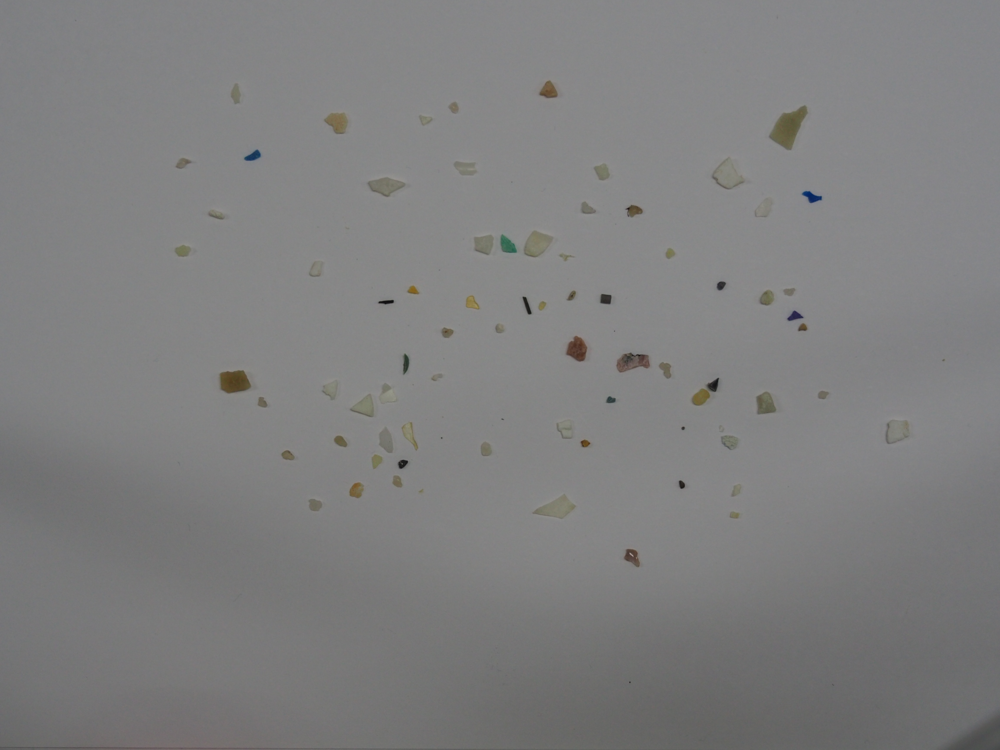
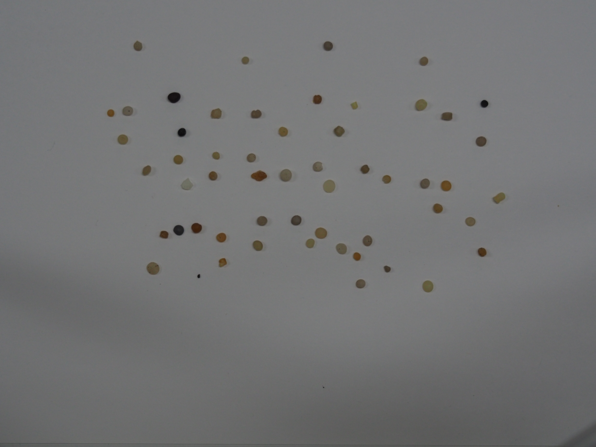
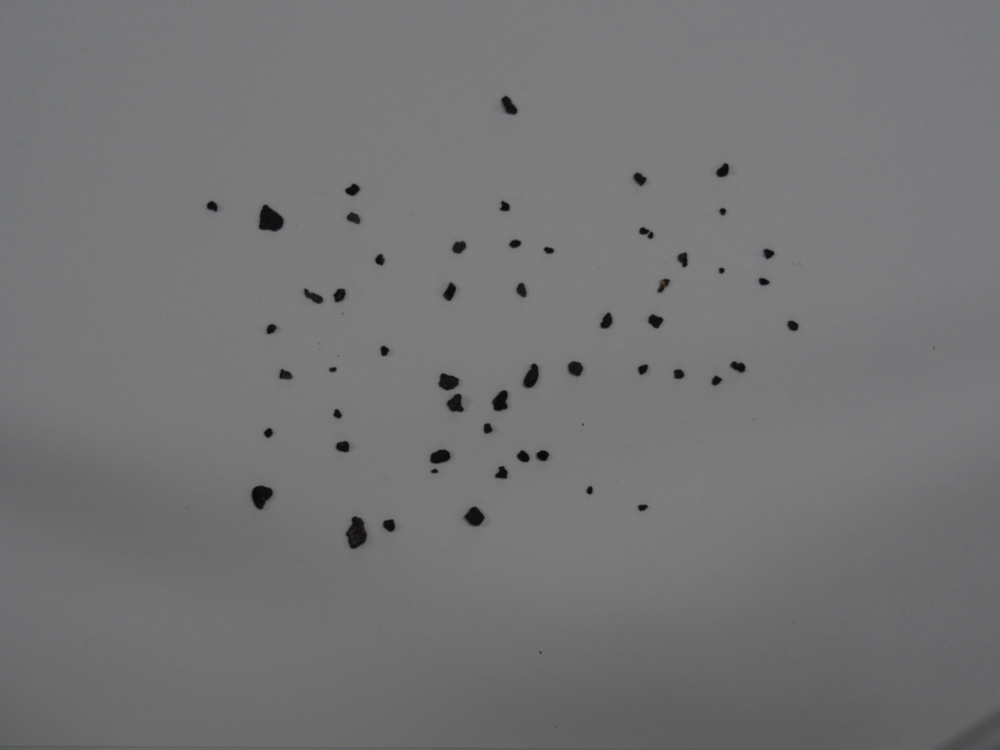
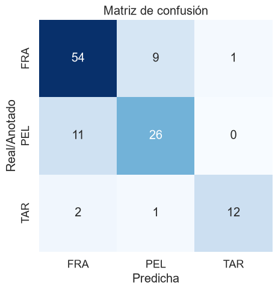
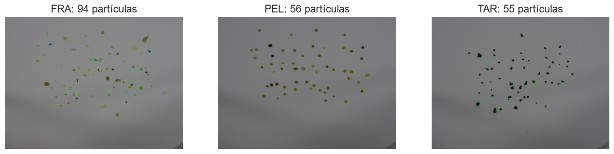
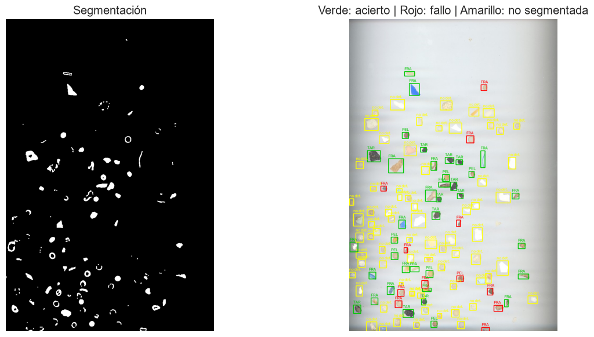

# Práctica de Detección y reconocimiento de formas

## Autores:

#### Grupo G43
Cristian Tomás Vega Appelqvist [[GitHub](https://github.com/Pegasos2005)]  
Helena González Báez [[GitHub](https://github.com/heleengb)]

Detección de monedas y clasificación de microplásticos con OpenCV.

## Contenido

| Archivo | Descripción |
|---|---|
| `VC_P3_resuelto.ipynb` | Notebook de la práctica con las celdas originales y las soluciones de las dos tareas |
| `README.md` | Este documento |


## Requisitos

```
pip install opencv-python numpy matplotlib seaborn scikit-learn
```

Ejecutar las celdas en orden. Las ventanas de OpenCV (clic y cámara) necesitan entorno gráfico local.

---

## Tarea 1: Dinero en la imagen de monedas

### Método
1. **Mapa de diferencia con el fondo** (`mapa_diferencia`): el color de fondo se estima con una mediana grande sobre una versión reducida de la imagen (aguanta degradados de luz) y cada píxel vale cuánto se aleja de ese fondo. Así da igual que las monedas sean más claras u oscuras.
2. **Detección** (`detectar_monedas`): se binariza el mapa con varios umbrales, del estricto (Otsu) al laxo (el estricto separa monedas vecinas con sombra y el laxo recupera las poco contrastadas). En cada uno se buscan círculos por **contornos** (con filtro de circularidad) y con la **Transformada de Hough** sobre la máscara (encuentra las que se tocan o solapan). Cada moneda se queda con la primera vez que aparece.
3. **Afinado y validación** (`refinar_circulo`): se mide el borde real de cada moneda (máxima caída del mapa de diferencia en 90 direcciones) y se ajusta un círculo por mínimos cuadrados con la mediana, así no afectan sombras ni monedas vecinas. Si no hay borde suficiente alrededor, se descarta como falso positivo.
4. **Calibración** (`pedir_clic`, `calibrar`): el usuario hace clic sobre una moneda de 1 €, cuyo diámetro real es 23.25 mm. `mm_por_píxel = 23.25 / (2 · radio_px)`. Si el clic no funciona en tu entorno, el notebook permite elegir la moneda por su número.
5. **Clasificación** (`clasificar_moneda`): se pasa el diámetro de cada moneda a mm y se asigna al valor con diámetro real más cercano. Si la diferencia supera 1.5 mm, se marca como `?` y no suma.
6. **Suma** (`procesar_monedas`): se dibuja cada moneda con su valor y se suma el total.

Si la segmentación no es buena, `detectar_monedas(img, umbral=40)` fija el umbral a mano (0-255).

Diámetros usados (mm): 1 c = 16.25, 2 c = 18.75, 5 c = 21.25, 10 c = 19.75, 20 c = 22.25, 50 c = 24.35 (valor del enunciado), 1 € = 23.25, 2 € = 25.75.

### Demostrador en vivo (`demo_camara`)
Reutiliza las mismas funciones sobre cada fotograma de la cámara.

| Control | Acción |
|---|---|
| Clic en una moneda de 1 € | Calibra la escala |
| `r` | Borra la calibración |
| `b` | Ver / ocultar la segmentación |
| `+` / `-` | Fijar el umbral a mano y subirlo / bajarlo (`a` = automático) |
| `q` / `ESC` | Salir |

Tras calibrar: verde = moneda reconocida, rojo con `?` = no encaja con ninguna moneda. El total se muestra arriba a la izquierda.

### ¿Funciona? Problemas observados
- **Perspectiva y distancia:** la escala solo es válida si todas las monedas están a la misma distancia que la de referencia y la cámara es perpendicular a la mesa. Si la cámara se mueve hay que recalibrar.
- **Diámetros parecidos:** 20 c (22.25), 1 € (23.25) y 50 c (24.35) difieren ~1 mm; con poca resolución o borde ruidoso se confunden. El color (cobre / dorado / bimetálico) mejoraría la clasificación.
- **Iluminación:** sombras y reflejos alteran el contorno y, con él, el diámetro medido.
- **Objetos que no son monedas:** los no redondos se descartan por circularidad; los redondos de tamaño parecido a una moneda se contarán como moneda; los de otro tamaño salen con `?`.
- **Solape:** dos monedas que se tocan forman un único contorno no circular y no se cuentan. Alternativas: Transformada de Hough o *watershed*.
- **Fondo:** necesita contraste con las monedas. Monedas de cobre sobre madera es un caso difícil; un folio blanco o superficie lisa oscura funciona mucho mejor.
- **Resolución:** si las monedas ocupan pocos píxeles, 1 px de error son varias décimas de mm y se confunden las de tamaño parecido.


---

### Tarea 2 – Clasificación de microplásticos (FRA / PEL / TAR)

Pipeline clásico de visión por computador (sin aprendizaje profundo / *deep learning*) que segmenta partículas de microplásticos en una imagen y clasifica cada una como FRA (fragmento), PEL (pellet) o TAR (alquitrán). Se encuentra en la última sección de `VC_P3_mejorado.ipynb`.

#### Archivos
| Archivo | Propósito |
| :--- | :--- |
| `VC_P3_mejorado.ipynb` | Cuaderno (*notebook*) con la solución completa |
| `fragment-03-olympus-10-01-2020.JPG` | Imagen de entrenamiento, FRA (2576×1932) |
| `pellet-03-olympus-10-01-2020.JPG` | Imagen de entrenamiento, PEL |
| `tar-03-olympus-10-01-2020.JPG` | Imagen de entrenamiento, TAR |
| `MPs_test.jpg` | Escaneo de prueba (790×1186) |
| `MPs_test_bbs.csv` | Anotaciones de prueba (etiqueta, x_min, y_min, x_max, y_max, 120 partículas) |

#### Requisitos
`opencv-python`, `numpy`, `scipy`, `scikit-image`, `scikit-learn`, `matplotlib`, `seaborn`, `pandas`.

#### Pipeline (Flujo de procesamiento)
1. **Estimación del fondo**. Un filtro de mediana grande (`KERNEL_FONDO = 41`) sobre la imagen en el espacio Lab proporciona un fondo local que absorbe el viñeteado y las rayas del escáner.
2. **Segmentación**. Se calcula la distancia euclidiana de cada píxel a ese fondo en el espacio CIELAB, de modo que se tienen en cuenta los cambios de luminosidad y tono/saturación. Un umbral por histéresis (`UMBRAL_BAJO = 10`, `UMBRAL_ALTO = 14`) conserva los *blobs* (regiones) que contienen al menos un píxel fuerte y los expande hasta sus bordes pálidos. Luego se rellenan los huecos, se aplica una apertura morfológica de 3×3 y se descartan los contornos más pequeños que `AREA_MIN_MP`.
3. **Extracción de características** (por contorno):
   * **Forma** (basado en el artículo SMACC): compacidad, proporción área/caja delimitadora (*bounding-box*), relación de aspecto del *bounding-box*, relación de los ejes de la elipse asimilada, relación de distancia mínima/máxima al centroide, además de la solidez y circularidad.
   * **Color** relativo al fondo local, medido en el interior erosionado: ΔL, Δa, Δb, croma, desviación estándar de L, mínimo de L.
4. **Entrenamiento**. Las tres imágenes completas se reescalan por `ESCALA_TRAIN = 0.56` para que las partículas tengan el mismo tamaño en píxeles que en el escaneo de prueba. Cada partícula segmentada es una muestra (aproximadamente 72 FRA, 55 PEL, 53 TAR). Las características se estandarizan y se ajusta un clasificador kNN (k = 5).





5. **Evaluación**. Cada caja (*box*) anotada se empareja con el contorno más grande cuyo centroide cae dentro de ella. Se generan las métricas de exactitud (*accuracy*), precisión, exhaustividad (*recall*), F1, la matriz de confusión y una imagen superpuesta codificada por colores. La imagen de prueba nunca se utiliza para el entrenamiento.

#### Parámetros clave
| Parámetro | Valor | Significado |
| :--- | :--- | :--- |
| `UMBRAL_BAJO` / `UMBRAL_ALTO` | 10 / 14 | Umbrales de histéresis sobre la distancia Lab |
| `KERNEL_FONDO` | 41 px | Tamaño de la mediana del fondo; debe superar a la partícula más grande |
| `AREA_MIN_MP` | 80 px | Área mínima de la partícula a la resolución de prueba |
| `ESCALA_TRAIN` | 0.56 | Factor de redimensionamiento para las fotos de entrenamiento |

**Elección de AREA_MIN_MP**: aproximadamente 0,2 × el área mediana de los *pellets*. Por debajo de unos 50 px solo aparece polvo y ruido; las partículas reales comienzan alrededor de los 150 px (exceptuando las fibras finas). Si cambias la resolución de la imagen, debes escalar este valor de forma proporcional.

#### Resultados en MPs_test.jpg
| Métrica | Versión anterior | Esta versión |
| :--- | :--- | :--- |
| Partículas anotadas detectadas (de 120) | 49 | 116 |
| Exactitud (*Accuracy*) en partículas detectadas | 0.76 | 0.78 |
| Exactitud sobre el total de 120 (omisiones = errores) | ≈ 0.31 | ≈ 0.76 |

* **Por clase** (esta versión, partículas detectadas): FRA precisión 0.76 / *recall* 0.94; PEL 0.80 / 0.65; TAR 1.00 / 0.47.
* **Comparativa de segmentación** (partículas anotadas detectadas, `AREA_MIN` = 80): escala de grises + Otsu = 37, escala de grises + umbral adaptativo = 60, distancia Lab + histéresis = 116.






#### Limitaciones conocidas
* **Cámara vs escáner**. Las fotos de entrenamiento provienen de una cámara y la prueba de un escáner, por lo que el color y el contraste difieren. Las características de color relativas al fondo mitigan esto, pero no lo eliminan por completo.
* **Sesgo residual hacia FRA**. Los *pellets* muy pálidos pierden su forma redonda al ser segmentados, y los alquitranes (TAR) alargados y de tono amarronado son menos oscuros que el alquitrán de entrenamiento, por lo que ambos terminan etiquetados erróneamente como FRA.
* Las partículas que se tocan se fusionan en un solo contorno (esto provoca al menos una omisión en la detección).
* **Probado y descartado**: un cierre morfológico más grande (fusiona partículas vecinas, 5 detecciones menos) y características de dirección de tono normalizadas (peor *recall* en la clase PEL).

#### Posibles mejoras
* Añadir algunas partículas etiquetadas procedentes del escáner al conjunto de entrenamiento.
* Separar las partículas que se tocan utilizando una transformación de distancia y el algoritmo *watershed* (cuencas hidrográficas).
* Añadir características de textura o de brillos especulares (reflejos).