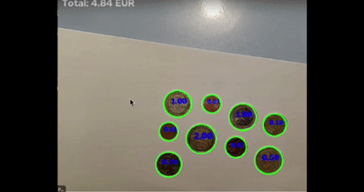
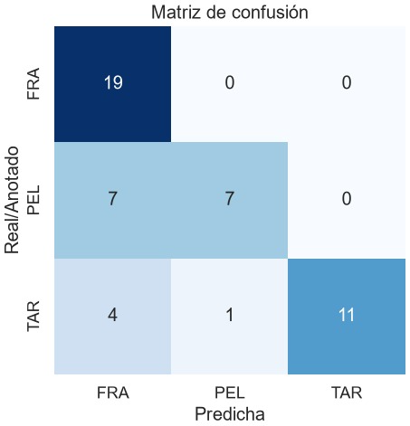

# Práctica de Detección y reconocimiento de formas

## GitHub Autores:
Tomás: https://github.com/Pegasos2005
Helen: https://github.com/heleengb

Detección de monedas y clasificación de microplásticos con OpenCV.

## Contenido

| Archivo | Descripción |
|---|---|
| `VC_P3_resuelto.ipynb` | Notebook de la práctica con las celdas originales y las soluciones de las dos tareas |
| `README.md` | Este documento |

Archivos de datos necesarios, en la misma carpeta que el notebook: `Monedas.jpg`, `MPs_test.jpg`, `MPs_test_bbs.csv`, `FRA.png`, `PEL.png`, `TAR.png`.

## Requisitos

```
pip install opencv-python numpy matplotlib seaborn scikit-learn
```

Ejecutar las celdas en orden. Las ventanas de OpenCV (clic y cámara) necesitan entorno gráfico local.

---

## Tarea 1: Dinero en la imagen de monedas

### Método
1. **Mapa de diferencia con el fondo** (`mapa_diferencia`): el color de fondo se estima con una mediana grande sobre una versión reducida de la imagen (aguanta degradados de luz) y cada píxel vale cuánto se aleja de ese fondo. Así da igual que las monedas sean más claras u oscuras.
2. **Detección** (`detectar_monedas`): se binariza el mapa con varios umbrales, del estricto (Otsu) al laxo (el estricto separa monedas vecinas con sombra y el laxo recupera las poco contrastadas). En cada uno se buscan círculos por **contornos** (con filtro de circularidad) y con la **Transformada de Hough** sobre la máscara (encuentra las que se tocan o solapan). Cada moneda se queda con la primera vez que aparece.
3. **Afinado y validación** (`refinar_circulo`): se mide el borde real de cada moneda (máxima caída del mapa de diferencia en 90 direcciones) y se ajusta un círculo por mínimos cuadrados con la mediana, así no afectan sombras ni monedas vecinas. Si no hay borde suficiente alrededor, se descarta como falso positivo.
4. **Calibración** (`pedir_clic`, `calibrar`): el usuario hace clic sobre una moneda de 1 €, cuyo diámetro real es 23.25 mm. `mm_por_píxel = 23.25 / (2 · radio_px)`. Si el clic no funciona en tu entorno, el notebook permite elegir la moneda por su número.
5. **Clasificación** (`clasificar_moneda`): se pasa el diámetro de cada moneda a mm y se asigna al valor con diámetro real más cercano. Si la diferencia supera 1.5 mm, se marca como `?` y no suma.
6. **Suma** (`procesar_monedas`): se dibuja cada moneda con su valor y se suma el total.

Si la segmentación no es buena, `detectar_monedas(img, umbral=40)` fija el umbral a mano (0-255).

Diámetros usados (mm): 1 c = 16.25, 2 c = 18.75, 5 c = 21.25, 10 c = 19.75, 20 c = 22.25, 50 c = 24.35 (valor del enunciado), 1 € = 23.25, 2 € = 25.75.

### Demostrador en vivo (`demo_camara`)
Reutiliza las mismas funciones sobre cada fotograma de la cámara.

| Control | Acción |
|---|---|
| Clic en una moneda de 1 € | Calibra la escala |
| `r` | Borra la calibración |
| `b` | Ver / ocultar la segmentación |
| `+` / `-` | Fijar el umbral a mano y subirlo / bajarlo (`a` = automático) |
| `q` / `ESC` | Salir |

Tras calibrar: verde = moneda reconocida, rojo con `?` = no encaja con ninguna moneda. El total se muestra arriba a la izquierda.

### ¿Funciona? Problemas observados
- **Perspectiva y distancia:** la escala solo es válida si todas las monedas están a la misma distancia que la de referencia y la cámara es perpendicular a la mesa. Si la cámara se mueve hay que recalibrar.
- **Diámetros parecidos:** 20 c (22.25), 1 € (23.25) y 50 c (24.35) difieren ~1 mm; con poca resolución o borde ruidoso se confunden. El color (cobre / dorado / bimetálico) mejoraría la clasificación.
- **Iluminación:** sombras y reflejos alteran el contorno y, con él, el diámetro medido.
- **Objetos que no son monedas:** los no redondos se descartan por circularidad; los redondos de tamaño parecido a una moneda se contarán como moneda; los de otro tamaño salen con `?`.
- **Solape:** dos monedas que se tocan forman un único contorno no circular y no se cuentan. Alternativas: Transformada de Hough o *watershed*.
- **Fondo:** necesita contraste con las monedas. Monedas de cobre sobre madera es un caso difícil; un folio blanco o superficie lisa oscura funciona mucho mejor.
- **Resolución:** si las monedas ocupan pocos píxeles, 1 px de error son varias décimas de mm y se confunden las de tamaño parecido.



---

## Tarea 2: Clasificación de microplásticos (FRA / PEL / TAR)

### Pipeline
1. **Segmentación** (`segmentar_particulas`): se estima el color de fondo como la mediana de la imagen (las partículas son minoría), se mide la distancia de cada píxel a ese color y se aplica Otsu. Así funciona igual con partículas más claras u oscuras que el fondo. Después, morfología y contornos externos con un área mínima (`AREA_MIN_MP`, a ajustar según la resolución). Hay otros dos métodos seleccionables con `METODO_SEG`: `'otsu'` (gris) y `'adaptativo'` (para iluminación no uniforme).
2. **Características** (`extraer_caracteristicas`), por cada contorno:
   - Área y perímetro (px)
   - Compacidad (`perímetro² / área`)
   - Área de la partícula / área del contenedor
   - Relación ancho/alto del contenedor
   - Relación entre los ejes de la elipse ajustada
   - Relación entre distancia mínima y máxima del centroide al contorno
   - Apariencia: gris medio y saturación media dentro de la partícula
3. **Entrenamiento:** cada partícula segmentada de `FRA.png`, `PEL.png` y `TAR.png` es una muestra de su clase. Las características se normalizan (`StandardScaler`) y se entrena un **K vecinos más cercanos** (k = 3) de scikit-learn.
4. **Evaluación:** se segmenta `MPs_test.jpg` y se empareja cada anotación del CSV con la partícula más grande cuyo centroide cae dentro de su caja. Se calculan accuracy, precision, recall y F1 (medias ponderadas), el informe por clase y la **matriz de confusión**. También se cuentan las anotaciones sin partícula segmentada.

La imagen de test **no** se usa para entrenar, solo para evaluar.

### Decisión sobre las características
Por defecto se usan solo las que no dependen del tamaño en píxeles (`CARACT_USADAS`), para que el clasificador no falle si las imágenes de entrenamiento y test tienen distinta resolución. Área y perímetro se calculan igualmente y se pueden añadir a la lista.

### Resultados

| Métrica | Valor |
|---|---|
| Accuracy | |
| Precision (ponderada) | |
| Recall (ponderado) | |
| F1 (ponderado) | |
| Anotaciones sin segmentar | |



### Limitaciones
- Partículas pegadas se segmentan como un solo contorno.
- Iluminación no uniforme o poco contraste degradan la segmentación (probar `'adaptativo'`).
- Pocas muestras de entrenamiento limitan lo que puede aprender el KNN.
- El alquitrán (oscuro) y algunos fragmentos oscuros pueden solaparse en las características de intensidad.

### Posibles mejoras
Separar partículas pegadas con *watershed*, aumentar el número de muestras de entrenamiento y añadir más descriptores de color o textura.
