# Práctica de Detección y seguimiento de vehículos y matrículas

## Autores:

#### Grupo G43
Cristian Tomás Vega Appelqvist [[GitHub](https://github.com/Pegasos2005)]  
Helena González Báez [[GitHub](https://github.com/heleengb)]

Prototipo que procesa el vídeo de test de la práctica: detecta y sigue personas y vehículos, localiza las matrículas con un YOLO entrenado por nosotros, cuenta los objetos de cada clase y genera un vídeo y un CSV con los resultados. La lectura del texto de las matrículas (segunda parte) está en [P4B](../P4B/README.md).

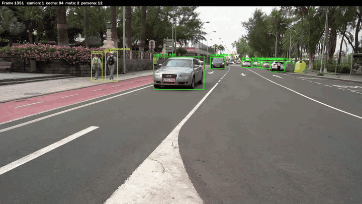

## Contenido

| Archivo | Descripción |
|---|---|
| `VC_P4.ipynb` | Notebook principal: dataset, entrenamiento de YOLO, prototipo sobre el vídeo, flujo y anonimización |
| `VC_P4_contornos.ipynb` | Extra: detección de matrículas por contornos y comparación con YOLO |
| `VC_P4_RTDETR_colab.ipynb` | Extra: entrenamiento de RT-DETR en Google Colab |
| `VC_P4_RTDETR.ipynb` | Extra: comparación YOLO vs RT-DETR |
| `dataset_matriculas/` | Dataset de matrículas en formato YOLO (train / val / test) |
| `runs/detect/` | Resultados de los entrenamientos (pesos, curvas y métricas) |
| `resultados/resultado.mp4` | Vídeo de test con las detecciones, los IDs de seguimiento y el conteo |
| `resultados/anonimizado.mp4` | Vídeo con personas y matrículas difuminadas |
| `resultados/detecciones.csv` | Detecciones y seguimiento de cada fotograma |
| `resultados/flujo.csv` | Dirección de cada objeto y borde por el que sale |

Los vídeos de `resultados/` están a 1280×720 (el original es 1920×1080) para no pasar del límite de 100 MB de GitHub, y en H.264 para que se puedan ver desde el navegador. El vídeo de entrada (`C0142.MP4`, 200 MB) no está en el repo, es el que da el enunciado.

## Requisitos

```
conda create -n VC_P4 python=3.11
conda activate VC_P4
pip install ultralytics lap opencv-python pandas matplotlib
```

`lap` hace falta para el seguimiento. Todo se ha ejecutado en CPU salvo el entrenamiento de RT-DETR, que se hizo en Colab. Ejecutar las celdas en orden.

---

## Tarea 1: Dataset y entrenamiento del detector de matrículas

### Dataset
Hemos juntado **2387 imágenes** con **5235 matrículas** anotadas (una sola clase, `matricula`). Las anotaciones originales son un `.json` por imagen con la caja normalizada (`rectangle = [xc, yc, w, h]`) y el texto de la matrícula (`plate`), que usamos luego en la P4B.

1. **Conversión a YOLO**: se pasa cada caja al formato `clase xc yc w h`, quitando las cajas degeneradas y recortando las que se salen de la imagen.
2. **Reparto**: aleatorio con semilla fija, 80 % para train+val y 20 % para test, y dentro del primero otra vez 80/20.
3. **Reescalado**: las imágenes se guardan a 1280 px de lado mayor. Las originales ocupaban unos 7 GB y así el entrenamiento en CPU va mucho más rápido.

| Split | Imágenes | Matrículas |
| :--- | :--- | :--- |
| train | 1528 | 3362 |
| val | 382 | 828 |
| test | 477 | 1045 |

**Acceso al dataset:** la versión ya preparada está en [`dataset_matriculas/`](./dataset_matriculas/). El dataset original (imágenes a resolución completa y los `.json`) está en este [Google Drive](https://drive.google.com/drive/folders/1RFd6sKH_QMQcpE_w5rWmy8rKiYUY5_SI). Para regenerar `dataset_matriculas/` basta con descargarlo en `P4/dataset_raw/annotations/` (las imágenes en `images/` dentro de esa carpeta) y ejecutar la primera celda del notebook.

### Entrenamiento
Partimos de `yolo11n.pt` (preentrenado en COCO) y lo ajustamos a la clase `matricula`.

| Parámetro | Valor |
| :--- | :--- |
| Épocas | 40 (`patience=10`) |
| `imgsz` / `batch` | 640 / 16 |
| Optimizador | AdamW, `lr0=0.002` (elegido automáticamente) |
| Equipo | CPU (AMD Ryzen 7 5700G), unas 2.6 h |

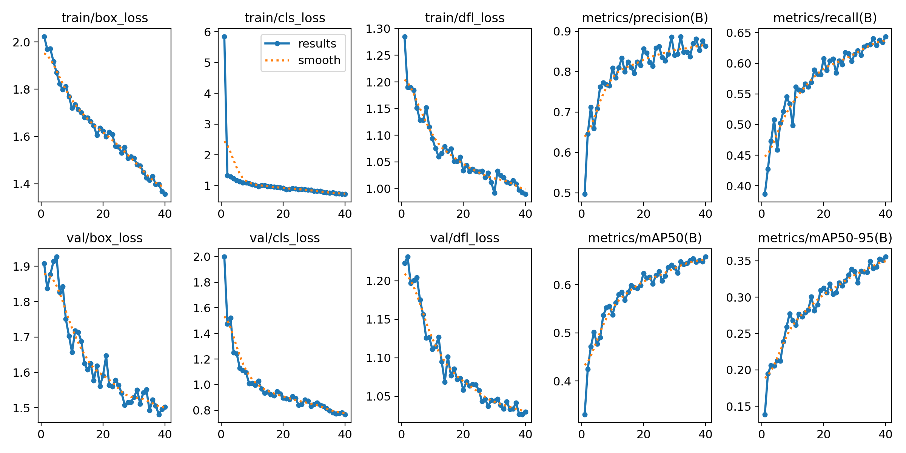

| Conjunto | Precisión | Recall | mAP@0.5 | mAP@0.5:0.95 |
| :--- | :--- | :--- | :--- | :--- |
| Validación (época 40) | 0.864 | 0.644 | 0.658 | 0.356 |
| Test | 0.889 | 0.600 | 0.619 | 0.334 |

### ¿Qué tal ha ido?
- Las pérdidas (caja, clase y DFL) bajan todo el rato tanto en train como en val, así que no hay sobreajuste.
- La mejor época es la última, o sea que todavía no había convergido. Con más épocas o con GPU seguramente mejoraría.
- La precisión es alta (~0.89) pero la exhaustividad (*recall*) se queda en ~0.60: cuando detecta algo casi siempre es una matrícula, pero se le escapan bastantes. Casi todas son matrículas muy pequeñas o lejanas, que con un modelo *nano* a 640 px se quedan en muy pocos píxeles.
- Test y validación dan resultados parecidos, así que generaliza bien a imágenes que no ha visto.

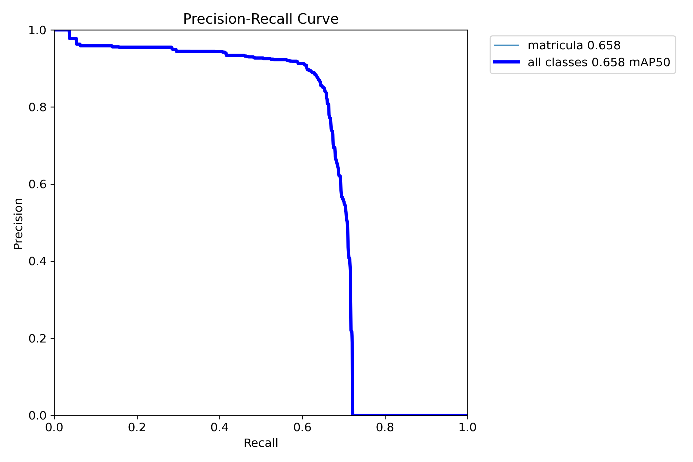

---

## Tarea 2: Prototipo sobre el vídeo de test

### Método
1. **Personas y vehículos**: `yolo11n.pt` en modo seguimiento (BoT-SORT) con las clases persona, bicicleta, coche, moto, autobús y camión.
2. **Matrículas**: cada vehículo con motor se recorta con un margen del 5 % y se le pasa el recorte a nuestro detector, quedándonos con la matrícula de más confianza. Así la matrícula queda asociada a su vehículo y ocupa más píxeles en la entrada del detector.
3. **Conteo**: número de IDs distintos por clase. Solo cuentan los tracks que aparecen en al menos 5 fotogramas, para no contar IDs sueltos.
4. **Salidas**: el vídeo con las cajas, los IDs y el conteo arriba, y el CSV.

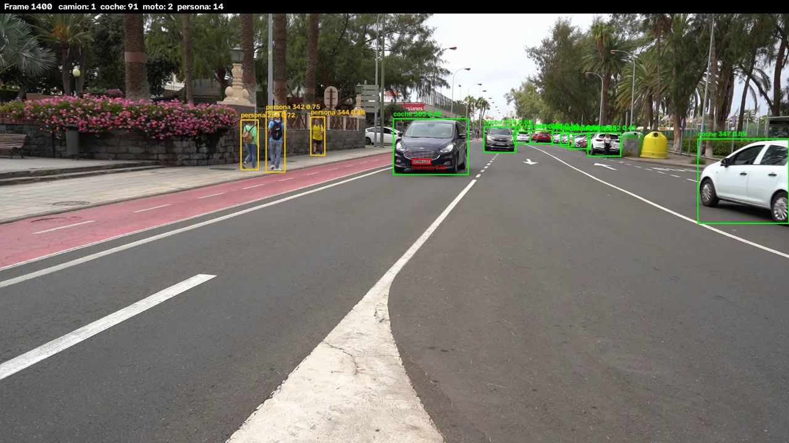

Vídeo completo: [`resultados/resultado.mp4`](./resultados/resultado.mp4)

### CSV (`resultados/detecciones.csv`)

```
fotograma, tipo_objeto, confianza, identificador_tracking, x1, y1, x2, y2,
matricula_en_su_caso, confianza_matricula, mx1, my1, mx2, my2, texto_matricula
```

`matricula_en_su_caso` vale `si` o `no` en los vehículos con motor y queda vacío en personas y bicis. Las coordenadas están en píxeles del vídeo original (1920×1080). Aquí `texto_matricula` está vacía; se rellena en la P4B.

### Resultados
Se procesan 2832 fotogramas con 21 013 detecciones. Hay 274 tracks, de los que 214 aparecen en al menos 5 fotogramas.

| Clase | Objetos distintos |
| :--- | :--- |
| coche | 180 |
| persona | 24 |
| moto | 6 |
| camión | 2 |
| bicicleta | 2 |

La matrícula se encuentra en el 10.8 % de las detecciones de vehículos (1926 de 17 806), y al menos una vez en 57 de los 188 vehículos. La proporción media de las cajas es de ~3.5:1, que cuadra con una matrícula real.

### Problemas observados
- **El conteo de coches está inflado.** Al fondo hay muchos coches aparcados, pequeños y tapándose unos a otros, y el tracker les pierde el ID y les da uno nuevo, así que el mismo coche cuenta varias veces. Se ve también en el flujo: 153 coches salen como "parados" y la mayoría de tracks desaparecen sin salir por ningún borde.
- La clase de cada track es la del último fotograma. Algunos autobuses acaban como coche o camión y por eso no salen en el conteo.
- Las matrículas lejanas se pierden casi siempre, por el *recall* de ~0.60 del detector.

---

## Extras

### Flujo por dirección (`resultados/flujo.csv`)
Para cada track se compara la posición media del centro en sus primeros y últimos fotogramas. El desplazamiento dominante da la dirección (izquierda, derecha, arriba o abajo) y si se mueve menos del 5 % del ancho se considera parado. También se mira por qué borde sale de la imagen.

| Clase | Derecha | Izquierda | Parado | Total |
| :--- | :--- | :--- | :--- | :--- |
| bicicleta | 0 | 2 | 0 | 2 |
| camión | 0 | 1 | 1 | 2 |
| coche | 4 | 23 | 153 | 180 |
| moto | 3 | 3 | 0 | 6 |
| persona | 9 | 3 | 12 | 24 |
| **total** | **16** | **32** | **166** | **214** |

| Borde de salida | Objetos |
| :--- | :--- |
| izquierda | 16 (+1 por la esquina superior izquierda) |
| derecha | 7 |
| desaparece dentro de la imagen | 185 |
| sigue en la imagen al acabar | 5 |

### Anonimización (`resultados/anonimizado.mp4`)
En la misma pasada se genera otro vídeo con un desenfoque gaussiano sobre cada persona y cada matrícula detectada, con el tamaño del kernel según el tamaño de la caja. De los coches solo se difumina la matrícula, que es lo que identifica al dueño.

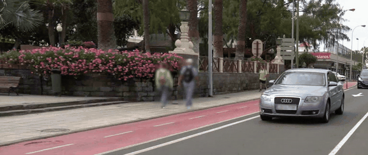

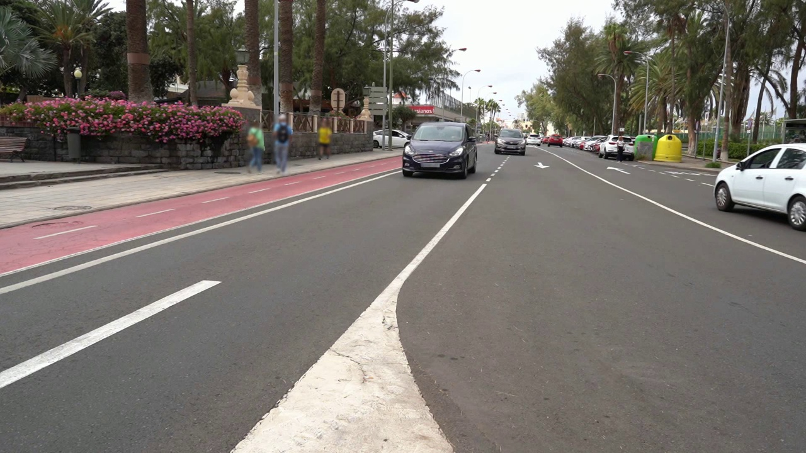

### Detección de matrículas por contornos (`VC_P4_contornos.ipynb`)
Alternativa clásica sin entrenamiento. La idea es que una matrícula es un rectángulo claro de proporción ~4.7:1 con letras oscuras, que dan muchos bordes verticales muy juntos.

1. **Black-hat** (13×5): resalta las letras oscuras sobre fondo claro.
2. **Sobel en x** y **cierre horizontal** (17×3): saca los bordes verticales y une las letras en un solo bloque.
3. **Umbral de Otsu** y limpieza morfológica, más una máscara de zonas claras (el fondo de la matrícula).
4. **Contornos** (`findContours`): nos quedamos con los rectángulos de proporción entre 2 y 7, tamaño razonable y relleno ≥ 0.45.
5. **Puntuación**: densidad de bordes × relleno × lo cerca que está la proporción de 4.5. Sirve para ordenar candidatos y sacar curvas PR como con YOLO. Se hace a 3 escalas y se fusiona con NMS.

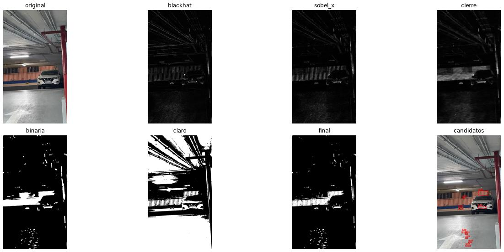

Lo hemos probado de dos formas: buscando en toda la imagen y buscando solo dentro de los vehículos (detectados con `yolo11n`, reescalados a 480 px de ancho y mirando solo el 65 % de abajo), que es como funciona el prototipo. Los parámetros se ajustaron con val y los resultados son sobre test, con el mismo evaluador para los dos métodos (IoU ≥ 0.5). Para comprobar el evaluador: a YOLO en imagen completa le da un AP50 de 0.618, y Ultralytics da 0.619.

| Método | Dónde busca | AP50 | P | R | F1 | ms/imagen |
| :--- | :--- | :--- | :--- | :--- | :--- | :--- |
| Contornos | imagen completa | 0.135 | 0.385 | 0.201 | 0.264 | 9 |
| YOLO | imagen completa | 0.618 | 0.878 | 0.614 | 0.723 | 22 |
| Contornos | dentro de vehículos | 0.259 | 0.503 | 0.357 | 0.417 | 7 |
| YOLO | dentro de vehículos | 0.590 | 0.717 | 0.658 | 0.686 | 26 |

P, R y F1 en el umbral con mejor F1. Tiempos en CPU (Ryzen AI 7 445), sin contar la detección de vehículos (25 ms/imagen).

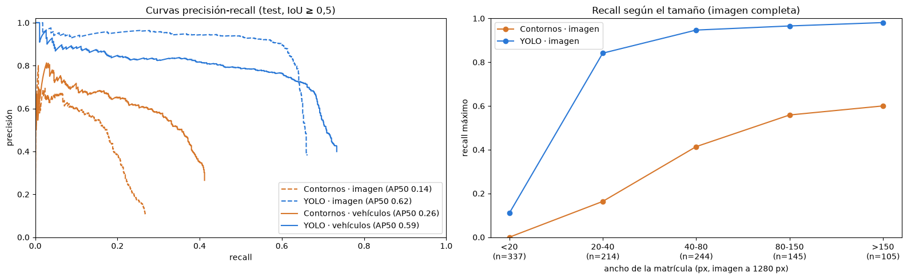

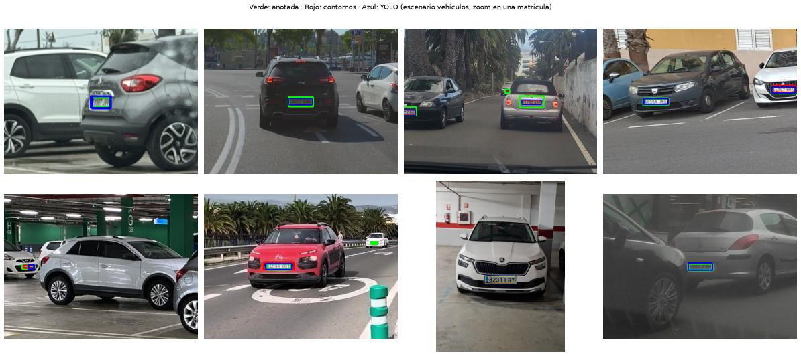

**¿Funciona?** Regular. YOLO es muchísimo mejor (F1 de 0.72 frente a 0.26 en imagen completa); los contornos solo ganan en velocidad y en que no necesitan datos anotados. Buscar dentro del vehículo casi duplica su AP50 (de 0.14 a 0.26) porque quita muchos falsos positivos (rejillas, carteles, marcas de la carretera). El gran problema es el tamaño: el 32 % de las matrículas de test miden menos de 20 px y ahí los contornos no encuentran ninguna, porque las letras no llegan a formar bordes. También fallan con matrículas inclinadas o en perspectiva, con poco contraste, o pegadas a zonas con muchos bordes como el parachoques.

### YOLO vs RT-DETR (`VC_P4_RTDETR_colab.ipynb`, `VC_P4_RTDETR.ipynb`)
RT-DETR es un detector basado en *transformers*, de Baidu. Hemos usado la versión de Ultralytics (`RTDETR('rtdetr-l.pt')`), así que el dataset, el `.yaml` y las métricas son exactamente los mismos que con YOLO.

**Entrenamiento.** En CPU tardaba días, así que lo entrenamos en Google Colab con una GPU Tesla T4, y tardó 77 minutos. Mismos ajustes que YOLO (`imgsz=640`, 40 épocas, `patience=10`), salvo el *batch*, que es 8 en lugar de 16 por la memoria de la GPU.

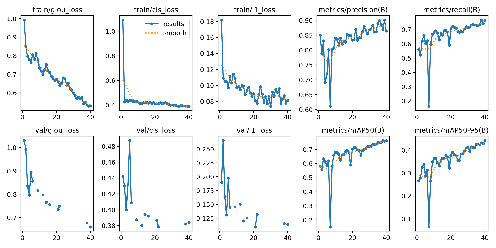

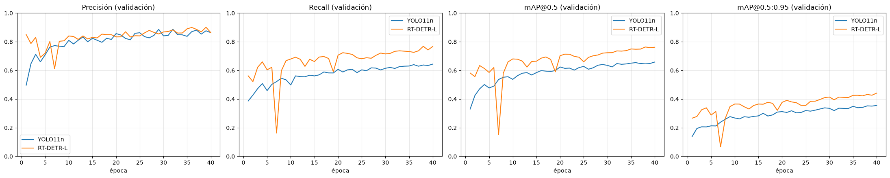

- Aprende mucho más rápido: en la época 1 ya tiene un mAP@0.5 de 0.58, al que YOLO no llega hasta la época 13. Va por delante en *recall* y mAP todo el entrenamiento.
- Al principio es menos estable (en la época 7 caen todas las métricas y luego se recupera).
- Igual que YOLO, la mejor época es la última, así que tampoco había convergido.
- Las pérdidas de validación salen `nan` en 26 de las 40 épocas (por eso hay huecos en las gráficas). Es un fallo de Ultralytics al calcular esa pérdida con AMP; las métricas sí se calculan en todas.

**Resultados en test** (las mismas 477 imágenes, tiempos en CPU):

| Modelo | Parámetros | Pesos | Precisión | Recall | mAP@0.5 | mAP@0.5:0.95 | Inferencia |
| :--- | :--- | :--- | :--- | :--- | :--- | :--- | :--- |
| YOLO11n | 2.6 M | 5.5 MB | 0.89 | 0.60 | 0.619 | 0.333 | 19 ms |
| RT-DETR-L | 32.8 M | 66 MB | 0.88 | 0.70 | 0.705 | 0.400 | 492 ms |

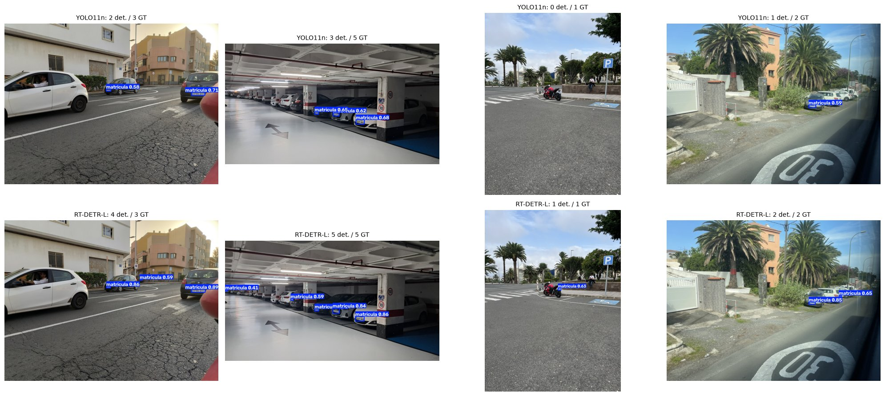

En los ejemplos (YOLO arriba, RT-DETR abajo) se ve que RT-DETR pilla matrículas pequeñas que YOLO no ve, como las del parking o la de la moto.

En el vídeo, buscando la matrícula en los recortes de los vehículos (1 de cada 10 fotogramas), RT-DETR la encuentra en el 22.6 % de los recortes y YOLO en el 5.4 % (aquí los dos a `imgsz=640`; en el prototipo usamos 320 y YOLO llega al 10.8 %). Cuando no coinciden suele ser el autobús, cuya matrícula RT-DETR sí detecta:

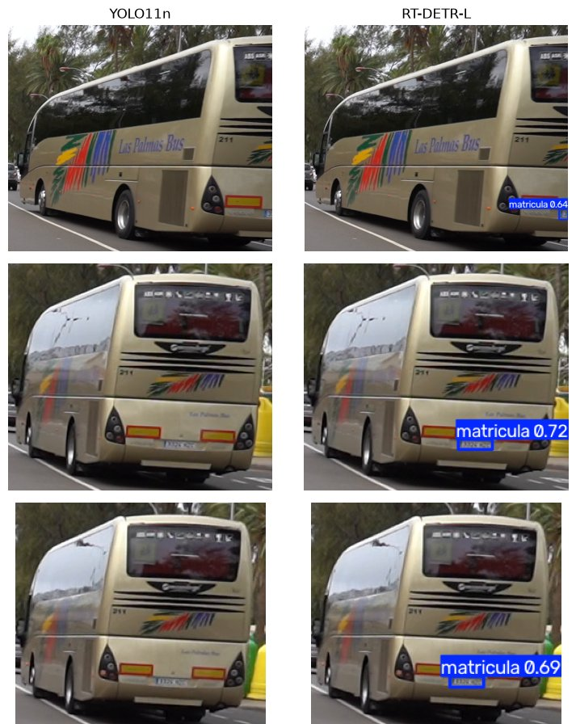

**Conclusión.** RT-DETR detecta mejor: un 14 % más de mAP@0.5 y un 20 % más de mAP@0.5:0.95, y sobre todo encuentra más matrículas (*recall* de 0.60 a 0.70) sin equivocarse más, que era justo lo que le fallaba a YOLO. El problema es el coste: 12 veces más parámetros, unas 26 veces más lento en CPU y no se puede entrenar sin GPU. Para el prototipo en un portátil sin GPU nos quedamos con YOLO; con GPU elegiríamos RT-DETR. Sobre la licencia, el RT-DETR original de Baidu es Apache 2.0, pero la versión de Ultralytics que hemos usado sigue siendo AGPL-3.0.
