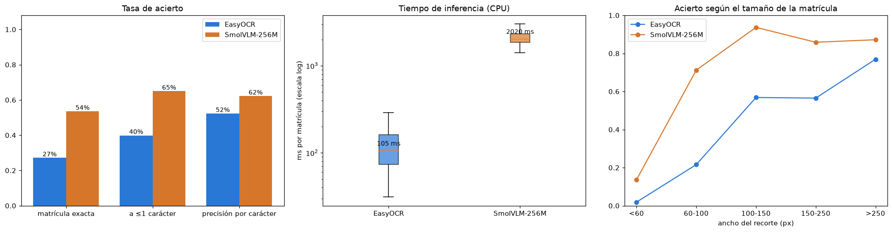
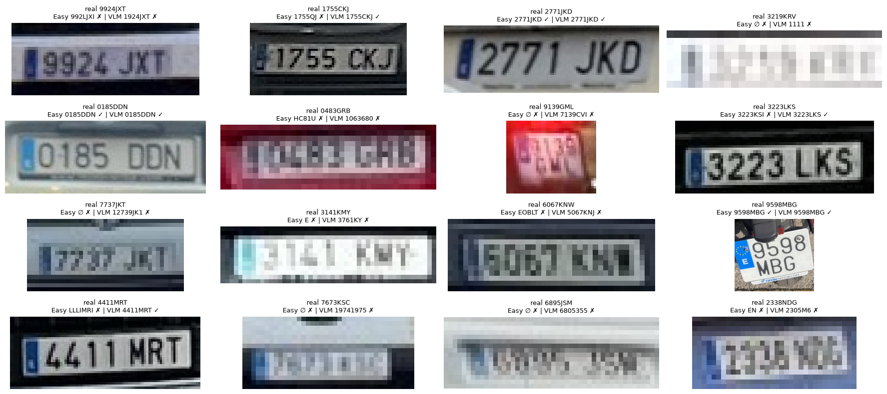
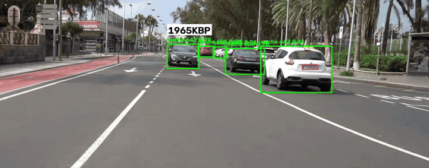
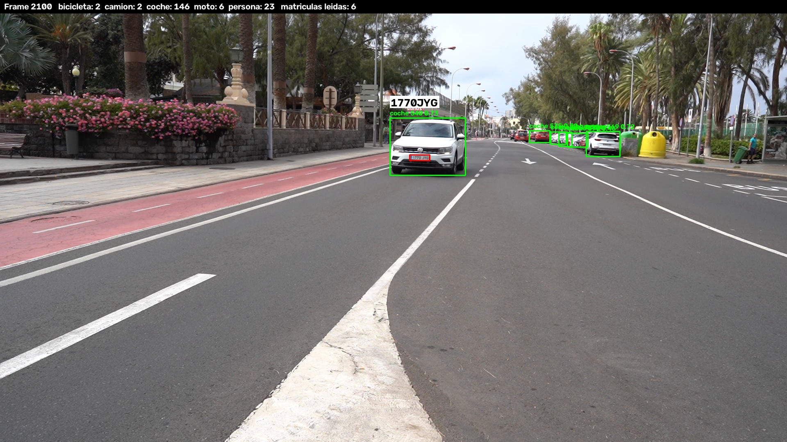
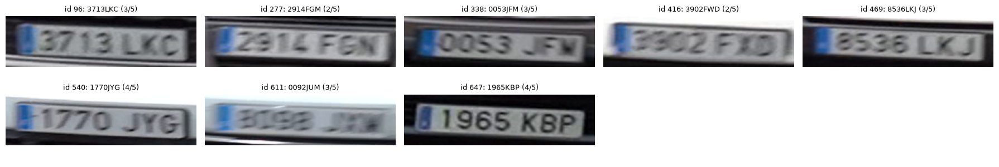

# Práctica 4b: Reconocimiento de caracteres en matrículas

Continuación de la [Práctica 4](../P4/README.md). Hace dos cosas:

1. **Compara dos OCR** para leer matrículas, uno clásico (**EasyOCR**) y un VLM (**SmolVLM-256M-Instruct**), en tiempo de inferencia y tasa de acierto.
2. **Completa el prototipo de la P4**: lee el texto de las matrículas detectadas en el vídeo de test, lo guarda en el CSV y lo muestra en el vídeo.

Todo el código está en el cuaderno [`VC_P4b_OCR.ipynb`](VC_P4b_OCR.ipynb), que usa el kernel `VC_P4`.
El cuaderno `VC_P4b.ipynb` es el de ejemplo del enunciado.

## Contenido de la carpeta

| Ruta | Descripción |
|---|---|
| `VC_P4b_OCR.ipynb` | Cuaderno con la comparativa y la integración en el vídeo |
| `resultados/comparativa_ocr.csv` | Salida de cada modelo para cada matrícula del conjunto de evaluación, con su tiempo |
| `resultados/detecciones.csv` | CSV de la P4 con `texto_matricula` y `texto_matricula_track` rellenos |
| `resultados/lecturas_video.csv` | Lecturas de los dos modelos sobre los recortes del vídeo que se leyeron |
| `resultados/resultado_ocr.mp4` | Vídeo de test con detecciones, seguimiento, conteo y matrícula leída (1280×720, H.264) |
| `imagenes/` | Gráficas y fotogramas usados en este README |

## Máquina y entorno

Todos los tiempos se han medido en el mismo portátil, **sin GPU**:

| | |
|---|---|
| CPU | AMD Ryzen AI 7 445 w/ Radeon 840M (12 hilos) |
| RAM | 30 GB |
| GPU | ninguna (inferencia en CPU) |
| SO | Linux (Fedora 44, kernel 7.2) |
| Software | Python 3.11, torch 2.15 (CPU), easyocr, transformers 5.23, ultralytics 8.4, opencv-python 5.0 |

```
conda create -n VC_P4 python=3.11
conda activate VC_P4
pip install torch torchvision --index-url https://download.pytorch.org/whl/cpu
pip install ultralytics lap easyocr transformers accelerate num2words pandas matplotlib ipykernel
```

## 1. Conjunto de evaluación

Se usa el dataset de matrículas de la P4. Las anotaciones originales (`.json`) incluyen, además de la caja, el texto de cada matrícula (`plate`).
Para no evaluar con imágenes vistas en el entrenamiento del detector, se toma solo el **split de test**.

- Se descartan las matrículas anotadas como `None`, porque el anotador las marcó como ilegibles.
- Quedan **629 matrículas** en 439 imágenes: 594 con formato actual (`1234ABC`), 32 con formato provincial antiguo (`GC1234AB`) y 3 con otros formatos.
- Cada matrícula se recorta a partir de su anotación, con un margen del 5 % en horizontal y del 15 % en vertical.
  El ancho mediano del recorte es de 71 px, y el 42 % mide menos de 60 px.

## 2. Modelos y condiciones del experimento

| | EasyOCR | SmolVLM-256M-Instruct |
|---|---|---|
| Tipo | OCR clásico: detector CRAFT + reconocedor CRNN | VLM general (HuggingFace), 256 M parámetros |
| Configuración | idioma `en`, `allowlist = 0-9A-Z`, fragmentos ordenados de izquierda a derecha | prompt *"Read the text on this license plate. Answer only with the characters."*, decodificación voraz, máx. 16 tokens |

Las condiciones son **idénticas para los dos modelos**:

- mismos 629 recortes;
- mismo preprocesado: si el recorte mide menos de 64 px de alto, se amplía hasta 64 px con interpolación cúbica;
- misma normalización de la salida: mayúsculas, solo `A-Z0-9`, y si aparece un patrón de matrícula española se queda solo ese patrón;
- misma máquina, CPU, *batch* 1, modelos ya cargados y 3 inferencias de calentamiento que no cuentan.

El tiempo incluye preprocesado e inferencia.

> **SmolVLM y el *image splitting*.** Por defecto, el procesador de SmolVLM parte cada imagen en 9 *tiles* de 512 px (619 tokens).
> En CPU eso supone unos 10 s por matrícula. Para un recorte tan pequeño no aporta nada: con `do_image_splitting=False` (89 tokens),
> las lecturas eran las mismas y el tiempo bajaba a unos 2,7 s, que en el experimento final quedaron en 2,0 s de mediana.

**Métricas:**

- *Acierto de matrícula*: la predicción coincide exactamente con el texto real.
- *A ≤1 carácter*: la distancia de edición a la real es como mucho 1.
- *Precisión por carácter*: 1 − CER, siendo CER la distancia de Levenshtein dividida por la longitud real.

## 3. Resultados de la comparativa



| Modelo | Acierto de matrícula | A ≤1 carácter | Precisión por carácter | Tiempo medio | Mediana | p95 | Matrículas/s |
|---|---|---|---|---|---|---|---|
| EasyOCR | 27,2 % | 39,9 % | 52,3 % | **131 ms** | **105 ms** | **248 ms** | **7,6** |
| SmolVLM-256M | **53,6 %** | **65,0 %** | **62,2 %** | 2 202 ms | 2 020 ms | 3 081 ms | 0,45 |

**Acierto según el ancho de la matrícula en la imagen:**

| Ancho (px) | Matrículas | EasyOCR | SmolVLM-256M |
|---|---|---|---|
| < 60 | 264 | 1,9 % | 13,6 % |
| 60–100 | 139 | 21,6 % | 71,2 % |
| 100–150 | 95 | 56,8 % | 93,7 % |
| 150–250 | 92 | 56,5 % | 85,9 % |
| > 250 | 39 | 76,9 % | 87,2 % |

**Acierto según el formato:** EasyOCR 27,8 % (actual) y 18,8 % (antiguo); SmolVLM 53,7 % y 56,2 %.

**Sobre la misma matrícula:** aciertan los dos en el 24,8 % de los casos, solo SmolVLM en el 28,8 %, solo EasyOCR en el 2,4 % y ninguno en el 44,0 %.



**Tipos de error:**

- **EasyOCR**:
  - con frecuencia no detecta ningún texto en matrículas pequeñas (su detector CRAFT falla antes de llegar al reconocedor);
  - confunde caracteres parecidos: `G→0`, `P→F`, `M→I`;
  - toma el borde o la banda azul por un carácter más.
- **SmolVLM**:
  - en matrículas legibles suele dar la matrícula entera y con su formato (`6118 MF8` frente a `6118NFB`), con errores de uno o dos caracteres;
  - cuando no ve bien la imagen **alucina**: devuelve secuencias como `111111111111111` o `12345`, o textos que no están en la imagen.
    Por eso conviene validar siempre su salida contra el formato esperado.

## 4. Integración en el vídeo de test

Se reutilizan la detección y el seguimiento de la P4 (`../P4/resultados/detecciones.csv`), con los mismos tracks y conteos, y se vuelve a recorrer `C0142.MP4`.

### El vídeo es mucho más difícil que el dataset

Las matrículas del vídeo miden de mediana 42×12 px. Cuando un coche pasa cerca de la cámara su matrícula se ve grande, pero sale muy movida.
Leer todas las detecciones (~1 900) sería caro con el VLM y casi inútil, porque la mayoría son ilegibles.

### Estrategia: pocos recortes buenos y votación por vehículo

1. Se recortan todas las matrículas detectadas y se mide su **nitidez** (varianza del laplaciano).
2. Para cada vehículo se eligen los **5 recortes más nítidos** de al menos 30 px de ancho y se leen con **SmolVLM**, el mejor de la comparativa.
3. Las lecturas con formato válido se guardan en `texto_matricula` del fotograma correspondiente.
4. **Votación por carácter:** con al menos 2 lecturas válidas, se toma posición a posición el carácter más votado.
   El resultado va a la nueva columna `texto_matricula_track` y se muestra en el vídeo encima del vehículo.
   En rojo, junto a la matrícula, aparece la lectura de cada fotograma leído.

Sobre los **mismos 140 recortes** del vídeo, SmolVLM produce un formato válido en el **20,0 %** de los casos y EasyOCR solo en el **2,9 %**.
En condiciones reales la diferencia entre los dos es todavía mayor que en el dataset.



*Fragmento recortado: la matrícula consolidada (`1965KBP`) aparece encima del coche y la lectura de cada fotograma en rojo, junto a la matrícula.
Vídeo completo: [`resultados/resultado_ocr.mp4`](resultados/resultado_ocr.mp4).*



### Resultado

- 60 vehículos con matrícula detectada. Solo **28** tienen algún recorte de al menos 30 px y **8** acaban con matrícula consolidada.
- El vídeo no tiene texto anotado, así que las 8 lecturas se han revisado a ojo con el recorte más nítido de cada vehículo:



| Track | Leída | Revisión visual | Lecturas válidas (coinciden) |
|---|---|---|---|
| 647 | 1965KBP | ✅ correcta | 4 (4) |
| 540 | 1770JYG | ✅ correcta | 4 (3) |
| 96 | 3713LKC | ✅ correcta | 3 (3) |
| 469 | 8536LKJ | ✅ correcta | 3 (3) |
| 338 | 0053JFM | ≈ última letra dudosa (M o W) | 3 (3) |
| 277 | 2914FGM | 1 carácter mal (FGN) | 2 (1) |
| 416 | 3902FWD | 1 carácter mal (FXD) | 2 (1) |
| 611 | 0092JUM | ❌ incorrecta, matrícula muy borrosa | 3 (0) |

Cuando las lecturas coinciden, el resultado es correcto. Cuando el consenso es bajo (0–50 %), hay errores.
El número de lecturas coincidentes sirve como indicador de confianza.

### Formato del CSV (`resultados/detecciones.csv`)

Es el formato de la P4, con dos columnas de matrícula:

```
fotograma, tipo_objeto, confianza, identificador_tracking, x1, y1, x2, y2,
matricula_en_su_caso, confianza_matricula, mx1, my1, mx2, my2, texto_matricula, texto_matricula_track
```

- `texto_matricula`: lectura de SmolVLM en ese fotograma (solo en los recortes leídos y con formato válido).
- `texto_matricula_track`: matrícula consolidada del vehículo, repetida en todas sus filas.

## 5. Conclusiones

- **Acierto:** SmolVLM-256M duplica el acierto de EasyOCR (53,6 % frente a 27,2 % de matrículas exactas) y lo supera en todos los tamaños y formatos.
  EasyOCR acierta solo en el 2,4 % de las matrículas en que falla SmolVLM, así que combinarlos aportaría poco.
- **Tiempo:** EasyOCR es unas **19 veces más rápido** (105 ms frente a 2,0 s de mediana en CPU). Puede funcionar casi en tiempo real; SmolVLM, en esta máquina, no.
- **El tamaño importa más que el modelo.** Por debajo de 60 px de ancho ninguno pasa del 14 %; a partir de 100 px, SmolVLM está entre el 86 y el 94 %.
  En el vídeo esto es lo que más limita: la mayoría de las matrículas son pequeñas o salen movidas.
- **Hay que validar la salida del VLM.** Cuando no ve la matrícula, SmolVLM inventa texto en lugar de devolver vacío.
  Filtrar por el formato de matrícula española elimina esas alucinaciones.
- **En vídeo hay que elegir qué leer.** Elegir los fotogramas más nítidos y votar por vehículo hace viable el VLM (140 lecturas en lugar de ~1 900)
  y corrige errores aislados.
- **Posibles mejoras:** usar un VLM especializado en OCR o con más parámetros si hay GPU, rectificar la perspectiva de la matrícula antes de leerla,
  y grabar el vídeo con más resolución o menos tiempo de exposición para reducir el desenfoque de movimiento.
